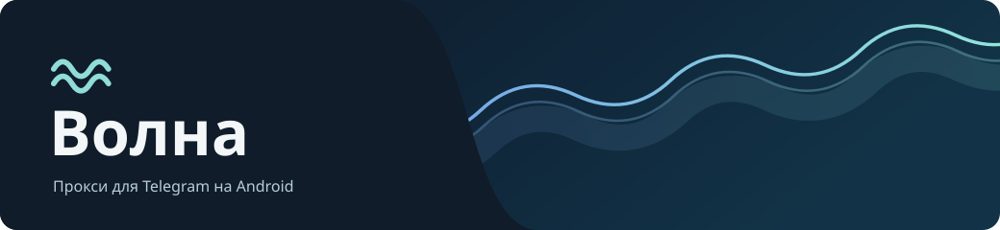
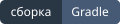
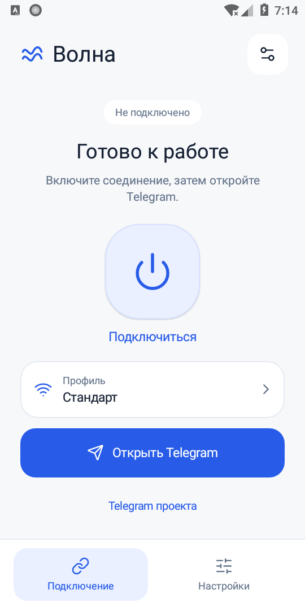
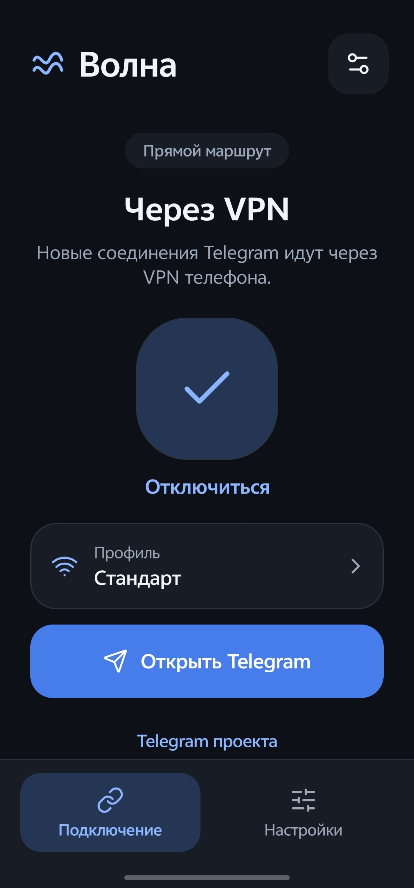

<p align="center"></p>
<p align="center">   </p>
<p align="center"><a href="../../releases/latest">Download APK</a> · <a href="README.md">Русский</a> · <a href="https://t.me/TgUnlock2026">Project channel</a></p>

Volna runs a proxy on your phone. Choose a route, tap **Connect**, then **Open Telegram** and accept the proxy in Telegram. When switching between Standard and an imported profile, open Telegram from Volna again to select the matching proxy type. Android 8 or later, ARM64, ARMv7, or x86_64.

| Route | Transport |
| --- | --- |
| Standard | Local MTProto → WebSocket through Cloudflare on port 80. Telegram's MTProto encryption remains active. This hop has no additional TLS layer. |
| Profiles | Authenticated local SOCKS5 → Xray. VLESS Reality supports TCP, XHTTP and gRPC. Hysteria 2 uses QUIC. |
| Direct over VPN | When enabled, new connections use the VPN assigned to Volna. The local listener keeps its address. Existing streams keep their original route while it is reachable. |

### Subscriptions and updates

Paste one profile URI per line or an HTTPS subscription URL under **Profile → Add profile**. Plain text and Base64 lists are supported. Refresh or delete a subscription from profile management. Private imports are encrypted with an Android Keystore key.

The official APK includes an offline starter catalog. Foreground checks fetch signed revisions from the project website. Invalid or stale revisions leave the last accepted catalog in place. You can refresh manually or change the website address in Settings. App updates use a patch for the installed APK and verify the manifest signature, hashes and signing certificate before opening the Android installer. When notifications are enabled, Android also checks for updates in the background. Tap the notification to open the update screen.

### On screen

| Light | Dark |
| :---: | :---: |
|  |  |

<details><summary>Connect, switch routes, change themes and open the wave scene</summary>

Five quick taps on the project name open the wave animation. The support dialog is dismissible immediately and remembers its first appearance. Animations respect the device motion setting.

</details>

### VPN routing

Android assigns a default network per application. Include Volna in your VPN's per-app list if you use split tunneling. A Telegram-only VPN does not cover the local proxy's outgoing sockets. Standard opens new DC sockets on the selected VPN network. Profile mode switches the outbound inside the running Xray process. When Android removes the old network, TCP streams using it may need to reconnect.

### Build from source

On Linux, install JDK 17, Go 1.27.3, and Rust stable. Set `ANDROID_HOME` to your Android SDK, then run:

```sh
sdkmanager "platforms;android-34" "build-tools;35.0.0" "ndk;27.2.12479018"
export ANDROID_NDK_HOME="$ANDROID_HOME/ndk/27.2.12479018"
rustup target add aarch64-linux-android armv7-linux-androideabi x86_64-linux-android
bash native-core/build-android.sh
bash scripts/build-xray-armv7.sh
./gradlew assembleDebug
```

Find the APK in `app/build/outputs/apk/debug/`. Both Xray downloads are pinned by SHA-256. A self-signed build can use Standard and manual imports immediately. Its update feed and online catalog must use its own signing identity. [Release packaging](docs/RELEASE.md)

```text
Kotlin views → Java foreground service ← Android default network
                  ├─ MTProto → Rust / JNI → WebSocket or direct TCP
                  └─ SOCKS5  → Xray       → profile or direct TCP
```

The UI lives in `app/src/main/kotlin`, service and transports in `app/src/main/java`, Rust crypto in `native-core`, and release tooling in `scripts`.

### Credits and contributing

Volna and the inherited TG Proxy 2026 code by Genuys use MIT. Xray-core is MPL 2.0. Kotlin and the Gradle Wrapper use Apache 2.0. Dependency and icon notices ship in the APK. The Cloudflare routing reference is tg-ws-proxy-android 1.13.0 (GPLv3). Subscription behavior was compared with exitFy 4.5.1. [License](LICENSE) · [Notices](app/src/main/assets) · [Xray](https://github.com/XTLS/Xray-core/tree/v26.10.31) · [tg-ws-proxy-android](https://github.com/malordin/tg-ws-proxy-android/tree/v1.13.0)

For bug reports, include Android version, route, network type and steps to reproduce. For VPN issues, include whether the VPN covers Volna. [Project chat](https://t.me/TgUnlock2026CHAT) · [Changelog](CHANGELOG.md)
