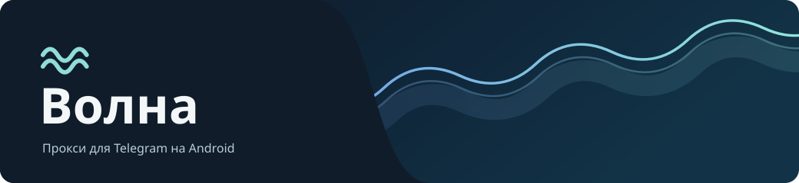
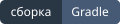
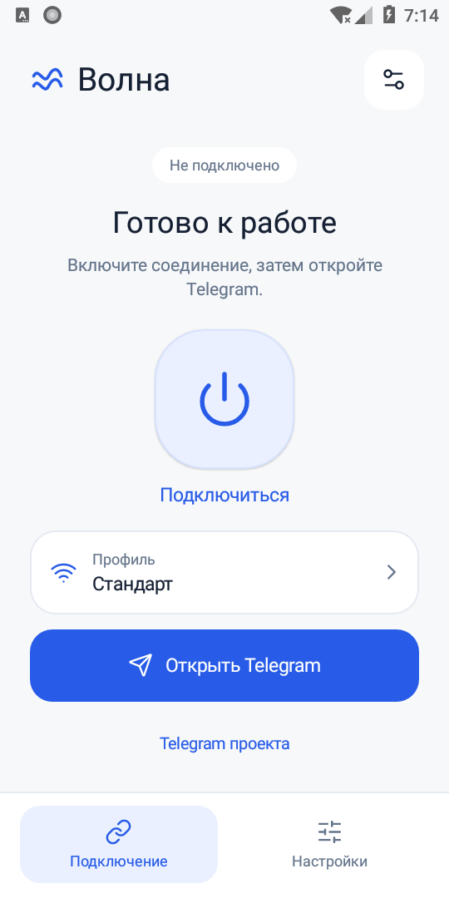
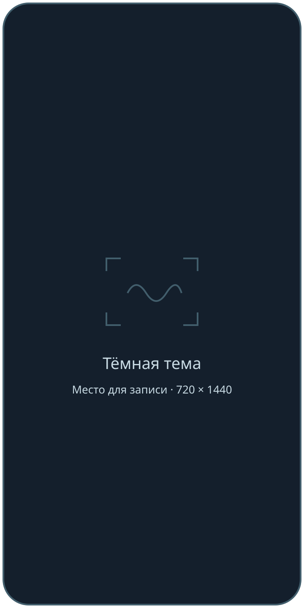
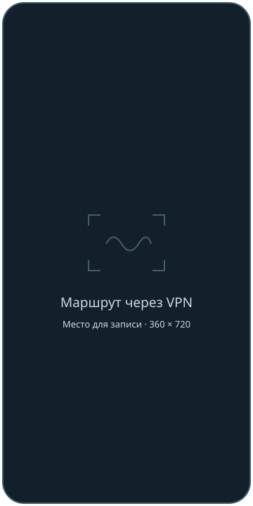
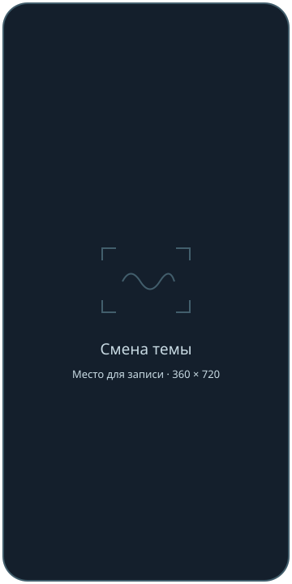
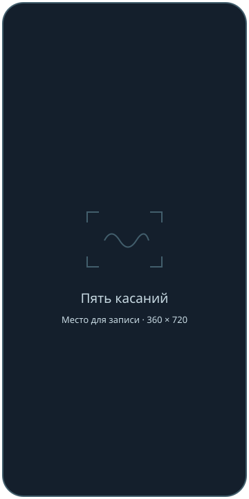

<p align="center"></p>
<p align="center">   </p>
<p align="center"><a href="../../releases/latest">Скачать APK</a> · <a href="README.en.md">English</a> · <a href="https://t.me/TgUnlock2026">Канал проекта</a></p>

«Волна» открывает локальный прокси на телефоне и передаёт его настройки в Telegram одной кнопкой. Можно пользоваться стандартным маршрутом, выбрать встроенный профиль или добавить свою подписку.

### Первое подключение

1. Установите APK из раздела **Releases**. Поддерживаются ARM64 и x86_64.
2. Откройте «Волну», выберите **Профиль** и нажмите **Подключиться**.
3. Нажмите **Открыть Telegram** и подтвердите добавление прокси. При переходе между «Стандартом» и профилем повторите этот шаг: Telegram сохраняет MTProto и SOCKS5 отдельно.

| Режим | Как идёт трафик |
| --- | --- |
| Стандарт | Telegram → локальный MTProto → WebSocket через Cloudflare, порт 80. Шифрование Telegram сохраняется. Дополнительного TLS на этом участке нет. |
| Профили | Telegram → локальный SOCKS5 с паролем → Xray. Поддерживаются VLESS Reality с TCP, XHTTP и gRPC, а также Hysteria 2 по QUIC. |
| Напрямую через VPN | При включённой настройке новые соединения идут к Telegram через VPN, доступный «Волне». Локальный адрес в Telegram сохраняется. |

### Профили и обновления

**Профиль → Добавить профиль** принимает ключи по одному на строку или HTTPS-подписку с обычным либо Base64-списком. В управлении можно обновить или удалить одну подписку целиком. Личные импорты хранятся с AES-GCM и ключом из Android Keystore.

Стартовые профили официального APK доступны офлайн. При открытии приложение периодически проверяет подписанный каталог сайта. Неверная подпись, старая ревизия и ошибка сети сохраняют предыдущий рабочий список. Ручная проверка находится в **Настройки → Обновить профили**. Если у проекта сменился домен, измените **Адрес сайта**.

**Проверить обновления** скачивает патч для установленной версии. Перед системным окном установки «Волна» проверяет подпись манифеста, хеш восстановленного APK и сертификат приложения.

### Интерфейс

| Подключение · светлая тема | Подключение · тёмная тема |
| :---: | :---: |
|  |  |

<details><summary>Подключение, VPN, смена темы и волна по пяти касаниям</summary>

| Подключение | VPN | Тема | Волна |
| :---: | :---: | :---: | :---: |
|  |  |  |  |

Сцену с волной открывают пять быстрых нажатий на название приложения. Диалог поддержки можно сразу закрыть, после первого показа это запоминается. Экранные эффекты учитывают настройку анимации устройства.

</details>

### Что происходит при VPN

«Волна» следит за сетью, назначенной Android **этому приложению**. При раздельном туннелировании включите «Волну» в список приложений VPN. Если VPN охватывает только Telegram, исходящие сокеты локального прокси принадлежат «Волне» и получают её маршрут.

В «Стандарте» для нового подключения к дата-центру открывается TCP-сокет на сети VPN. В SOCKS5 меняется правило маршрутизации внутри работающего Xray. Уже открытые TCP-сессии продолжаются на исходном маршруте, пока он доступен. После потери физической сети Telegram может открыть соединение заново. В «Стандарте» остаётся необходимая обработка локального MTProto.

### Устройство проекта

```text
Telegram ── MTProto ── TgWebEngine ── Rust / JNI ── WebSocket или TCP через VPN
         └─ SOCKS5 ─── Xray ────────────────────── профиль или прямой TCP
                         ↑
           Kotlin UI → LinkService ← сеть Android для UID приложения
```

| Путь | Назначение |
| --- | --- |
| `app/src/main/kotlin` | Экраны Android, диалоги, темы и анимации |
| `app/src/main/java` | Служба, локальные подключения, импорт, каталог и установка патчей |
| `native-core` | AES-CTR, разбор рукопожатия MTProto и обмен буферами по JNI |
| `scripts` | Проверяемая поставка Xray, подпись каталога и выпуск патчей |

### Сборка

На Linux понадобятся JDK 17, Android SDK 34, Build Tools 35.0.0, Android NDK r27c и Rust stable. Версии Gradle и плагинов закреплены в репозитории.

```sh
sdkmanager "platforms;android-34" "build-tools;35.0.0" "ndk;27.2.12479018"
export ANDROID_NDK_HOME="$ANDROID_HOME/ndk/27.2.12479018"
rustup target add aarch64-linux-android x86_64-linux-android
bash native-core/build-android.sh
./gradlew assembleDebug
```

APK появится в `app/build/outputs/apk/debug/`. Gradle проверяет SHA-256 обоих архивов Xray. Сборка с собственным сертификатом использует собственный подписанный каталог и цепочку обновлений. «Стандарт» и ручной импорт доступны сразу. [Подготовка каталога и релиза](docs/RELEASE.md)

### Лицензии и участие

Собственный код и части TG Proxy 2026 от Genuys распространяются по MIT. Xray-core — MPL 2.0, Kotlin и Gradle Wrapper — Apache 2.0. Уведомления о графике и зависимостях Rust входят в APK. Режим Cloudflare сверялся с поведением tg-ws-proxy-android 1.13.0 (GPLv3), формат импорта — с exitFy 4.5.1. [Лицензия](LICENSE) · [Уведомления](app/src/main/assets) · [Xray](https://github.com/XTLS/Xray-core/tree/v26.10.31) · [tg-ws-proxy-android](https://github.com/malordin/tg-ws-proxy-android/tree/v1.13.0)

При сообщении об ошибке укажите версию Android, профиль, тип сети и последний рабочий шаг. Для ошибок VPN уточните, включена ли «Волна» в список приложений VPN. [Чат проекта](https://t.me/TgUnlock2026CHAT) · [Изменения](CHANGELOG.md)
